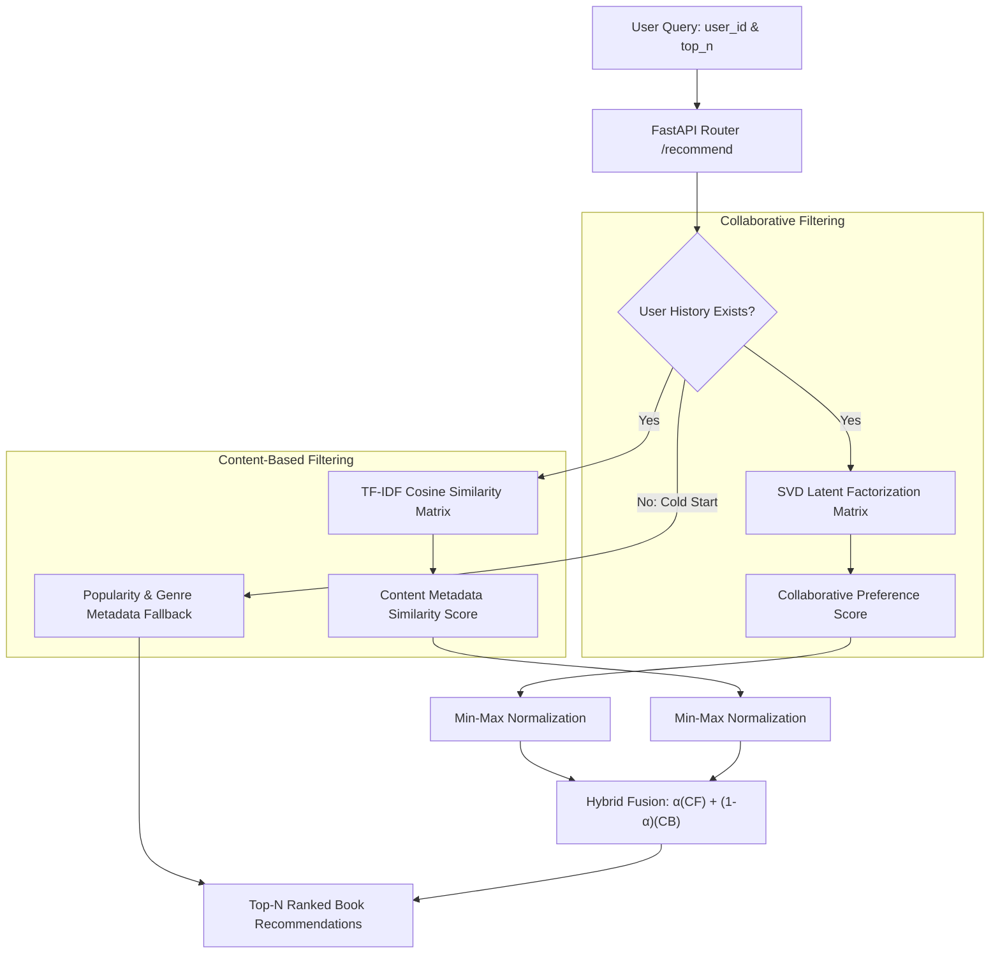

<div align="center">

# BookWise Recommender

### Hybrid recommendation engine combining SVD matrix factorisation and TF-IDF content similarity, served over a high-performance FastAPI interface.

[](https://www.python.org/)
[](https://fastapi.tiangolo.com/)
[](https://scikit-learn.org/)
[](https://docs.pydantic.dev/)
[](#)

[**Quick Start**](#quick-start) · [**System Architecture**](#system-design) · [**API Reference**](#api-reference) · [**Evaluation Metrics**](#evaluation-metrics) · [**Configuration**](#configuration)

</div>

---

## Overview

Standalone recommendation models face inherent trade-offs: pure **collaborative filtering** suffers from cold-start issues on new items or users, while pure **content-based filtering** tends to over-specialize and miss serendipitous discoveries.

**BookWise Recommender** addresses this by implementing an ensemble hybrid scoring architecture. It blends Singular Value Decomposition (**SVD matrix factorisation**) over historical user-rating interactions with **TF-IDF cosine similarity** over book metadata (title, author, genre, and synopsis), providing balanced, ranked recommendations served via an asynchronous FastAPI service.

---

## System Design & Hybrid Scoring



### Mathematical Formula

The unified hybrid score for user $u$ and item $i$ is formulated as:

$$\text{hybrid\_score}(u, i) = \alpha \cdot \text{norm}(\text{CF\_score}(u, i)) + \beta \cdot \text{norm}(\text{CB\_score}(u, i))$$

Where:
- $\alpha + \beta = 1.0$ (Default configuration: $\alpha = 0.60$, $\beta = 0.40$).
- Both score distributions are **min-max normalized** prior to blending to guarantee balanced weighting across disparate scale domains.

### Cold-Start Resolution Strategy

| User Profile | System Strategy |
|---|---|
| **Warm User** (Observed in interaction dataset) | Weighted hybrid ensemble ($\alpha \cdot \text{CF} + \beta \cdot \text{CB}$) |
| **Semi-Cold User** (Recent likes, not in matrix training) | Content-based similarity inferred from liked books |
| **Fully Cold User** (Brand new, zero interaction history) | Popularity-weighted genre similarity fallback |

---

## Project Structure

The project code is organized modularly (and packaged within `BookWise.zip` for standalone distribution):

```
BookWise/
├── settings.yaml          # Central hyperparameters, paths, and training configuration
├── generate_data.py       # Synthetic dataset generation engine
├── books_catalog.csv      # Book metadata catalogue
├── user_interactions.csv  # User-book rating interaction matrix
├── svd_engine.py          # SVD collaborative filtering matrix factorisation
├── tfidf_engine.py        # TF-IDF vectoriser and cosine similarity index
├── fusion.py              # Score normalisation and hybrid ensemble blending
├── metrics.py             # Precision@K, Recall@K, and NDCG@K ranking metrics
├── loader.py              # Configuration parser and data store provider
├── main.py                # FastAPI application entry point
├── router.py              # API endpoint route handlers
├── schemas.py             # Pydantic request & response validation schemas
├── train.py               # End-to-end model training pipeline
├── evaluate.py            # Offline benchmark and evaluation suite
├── evaluation_report.md   # Generated evaluation metrics report
└── requirements.txt       # Python dependencies
```

---

## Quick Start

### 1. Environment Setup

```bash
python -m venv venv
# Windows:
venv\Scripts\activate
# Linux/macOS:
source venv/bin/activate

pip install -r requirements.txt
```

### 2. Generate Data & Train Models

```bash
python train.py
```

This pipeline will:
- Generate synthetic interactions in `user_interactions.csv` and metadata in `books_catalog.csv`
- Train the SVD collaborative filter with 5-fold cross-validation
- Build the TF-IDF feature vocabulary and content similarity matrix
- Persist serialised model artefacts (`collab_model.pkl`, `content_model.pkl`, `hybrid_engine.pkl`)

### 3. Run Offline Evaluation

```bash
python evaluate.py
```

Computes ranking quality across test sets and writes output metrics to `evaluation_report.md`.

### 4. Start the FastAPI Service

```bash
uvicorn main:app --host 0.0.0.0 --port 8000 --reload
```

Interactive OpenAPI documentation is available at **http://localhost:8000/docs**.

---

## API Reference

### `GET /recommend/{user_id}`

Retrieves personalized top-N book recommendations for a specified user.

**Query Parameters:**
| Parameter | Type | Default | Description |
|---|:---:|:---:|---|
| `top_n` | int | `10` | Total recommendations to return (range: 1–50) |

**Sample Response (Warm User):**
```json
{
  "user_id": 42,
  "is_cold_start": false,
  "recommendations": [
    {
      "book_id": 87,
      "title": "The Quantum Labyrinth",
      "author": "Nadia Osei",
      "genre": "Literary Fiction",
      "avg_rating": 4.31,
      "score": 0.8214,
      "source": "hybrid"
    }
  ],
  "total": 1
}
```

**Sample Response (Cold-Start User):**
```json
{
  "user_id": 9999,
  "is_cold_start": true,
  "recommendations": [
    {
      "book_id": 12,
      "title": "Galactic Odyssey",
      "author": "Elena Voss",
      "genre": "Science Fiction",
      "avg_rating": 4.78,
      "score": 0.9100,
      "source": "content_based"
    }
  ],
  "total": 1
}
```

### `GET /health`

```json
{
  "status": "ok",
  "version": "1.0.0",
  "message": "BookWise Recommender API is running"
}
```

---

## Evaluation Metrics

The offline evaluation suite benchmarks performance across standard information retrieval metrics:

| Metric | Formulation | Description |
|---|:---:|---|
| **Precision@K** | $\frac{\text{Hits}@K}{K}$ | Proportion of top-$K$ recommended items relevant to the user |
| **Recall@K** | $\frac{\text{Hits}@K}{\|\text{Relevant}\|}$ | Proportion of all relevant user items captured in top-$K$ |
| **NDCG@K** | $\frac{\text{DCG}@K}{\text{IDCG}@K}$ | Normalized Discounted Cumulative Gain accounting for position discount |

---

## Configuration (`settings.yaml`)

Key parameters configurable without code changes:

```yaml
collaborative:
  algorithm: "SVD"
  n_factors: 50        # Latent factor dimensions
  n_epochs: 30         # Stochastic gradient descent iterations
  lr_all: 0.005        # Learning rate
  reg_all: 0.02        # L2 regularisation penalty

content_based:
  max_features: 5000   # TF-IDF vocabulary threshold
  ngram_range: [1, 2]  # Unigrams and bigrams

hybrid:
  collab_weight: 0.60  # α weight assigned to collaborative score
  content_weight: 0.40 # β weight assigned to content score
  top_n: 10

evaluation:
  relevance_threshold: 4.0  # Minimum rating treated as positive feedback
```

---

## Reproducibility

- The random seed is enforced globally in `settings.yaml` (`data.random_seed: 42`).
- Synthetic generation, train/test splitting, and matrix initializations consume this deterministic seed to ensure consistent benchmarking.
